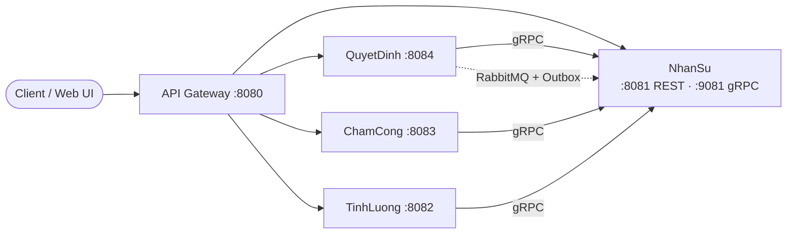

# HRM Microservices Demo

Hệ thống Quản lý Nhân sự (HRM) xây dựng theo kiến trúc **microservices** trên **.NET 8**. Hệ thống gồm 4 service nghiệp vụ đứng sau một **API Gateway (YARP)**, giao tiếp với nhau qua **gRPC** và **RabbitMQ (MassTransit + Transactional Outbox)**, kèm stack quan sát đầy đủ: Serilog/MongoDB, Prometheus/Grafana, OpenTelemetry/Jaeger.

📚 **Tài liệu chi tiết nằm trong [`docs/`](docs/README.md).**

## Kiến trúc



| Service | Thư mục | Chức năng |
|---|---|---|
| API Gateway | `ApiGateway/` | Reverse proxy, retry/circuit breaker theo từng service, Swagger tổng hợp, web UI kiểm thử |
| Nhân sự | `QuanLyNhanSuMicroservice/` | Nhân viên, phòng ban, chức vụ, văn bằng, tài khoản/JWT; gRPC server |
| Quyết định | `QuyetDinhService/` | Quyết định bổ nhiệm (event) và nâng lương (gRPC) |
| Chấm công | `ChamCongService/` | Loại chấm công, phiếu đăng ký nghỉ, bảng chấm công tháng |
| Tính lương | `TinhLuongService/` | Kỳ tính lương, tính lương cho toàn bộ nhân viên |

Mỗi service có database PostgreSQL riêng. NhanSu là nguồn dữ liệu gốc về nhân sự. Đọc thêm ở [docs/architecture.md](docs/architecture.md).

## Chạy nhanh

```bash
docker compose up -d --build
```

| URL | Nội dung |
|---|---|
| http://localhost:8080/ | **HRM Test Console**: web UI kiểm thử, có kịch bản end-to-end tự động |
| http://localhost:8080/swagger | Swagger tổng hợp của cả 4 service |
| http://localhost:15672 | RabbitMQ Management (`guest` / `guest`) |
| http://localhost:16686 | Jaeger |
| http://localhost:3000 | Grafana (`admin` / `admin`) |

Sau đó:

1. Mở http://localhost:8080/.
2. Nhập tên đăng nhập và mật khẩu, bấm **Đăng ký**.
3. Bấm **▶ Chạy toàn bộ** để kiểm tra mọi luồng.

Hoặc gọi API trực tiếp:

```bash
curl -X POST http://localhost:8080/api/nhansu/Auth/register -H "Content-Type: application/json" -d '{"username":"admin","password":"<mật khẩu>","role":"Admin"}'
```

```bash
curl -X POST http://localhost:8080/api/nhansu/Auth/login -H "Content-Type: application/json" -d '{"username":"admin","password":"<mật khẩu>"}'
```

Gửi token trong header `Authorization: Bearer <token>` cho các API khác. Cách chạy local bằng `dotnet run` có trong [docs/deployment.md](docs/deployment.md).

## Kiểm thử

```bash
dotnet test QuanLyNhanSuSystem.slnx
```

Có 179 unit test trong `tests/`, chia thành 5 project (4 service + Gateway). Nếu máy chỉ có runtime .NET mới hơn 8, chạy với `DOTNET_ROLL_FORWARD=Major`. Xem [docs/testing.md](docs/testing.md).

## Tài liệu

| Chủ đề | Tài liệu |
|---|---|
| Kiến trúc, luồng nghiệp vụ | [docs/architecture.md](docs/architecture.md) |
| REST qua Gateway, gRPC, RabbitMQ/Outbox | [docs/communication.md](docs/communication.md) |
| JWT, định dạng lỗi, concurrency, xoá mềm, logging/metrics/tracing | [docs/cross-cutting.md](docs/cross-cutting.md) |
| Entity, rule nghiệp vụ, API của từng service | [NhanSu](docs/services/nhansu.md) · [QuyetDinh](docs/services/quyetdinh.md) · [ChamCong](docs/services/chamcong.md) · [TinhLuong](docs/services/tinhluong.md) · [API Gateway](docs/services/api-gateway.md) |
| Khoá cấu hình, port, biến môi trường | [docs/configuration.md](docs/configuration.md) |
| Docker Compose, chạy local, migration | [docs/deployment.md](docs/deployment.md) |
| Unit test và web UI kiểm thử | [docs/testing.md](docs/testing.md) |
| Thêm API/RPC/event/migration, checklist PR | [docs/development.md](docs/development.md) |
| Lỗi thường gặp, giới hạn đã biết | [docs/troubleshooting.md](docs/troubleshooting.md) |

## Cấu trúc thư mục

```
HRM_Microservices_Demo/
├── ApiGateway/                  # YARP gateway (+ wwwroot/index.html: web UI kiểm thử)
├── QuanLyNhanSuMicroservice/    # Service Nhân sự (REST + gRPC server)
├── QuyetDinhService/            # Service Quyết định
├── ChamCongService/             # Service Chấm công
├── TinhLuongService/            # Service Tính lương
├── Protos/nhansu.proto          # Contract gRPC dùng chung
├── tests/                       # Unit test xUnit
├── docs/                        # Tài liệu chi tiết
├── docker-compose.yml
├── init-db.sql                  # Tạo 4 database PostgreSQL
├── prometheus.yml
└── QuanLyNhanSuSystem.slnx
```

## Công nghệ

.NET 8 / ASP.NET Core · Clean Architecture + CQRS (MediatR) · EF Core 8 + Npgsql · gRPC · MassTransit 8 + RabbitMQ (EF Core Outbox) · YARP + Polly · JWT + BCrypt · Serilog + MongoDB · prometheus-net · OpenTelemetry · xUnit + Moq

> ⚠️ Khoá JWT và mật khẩu hạ tầng trong repo chỉ dùng cho demo.
