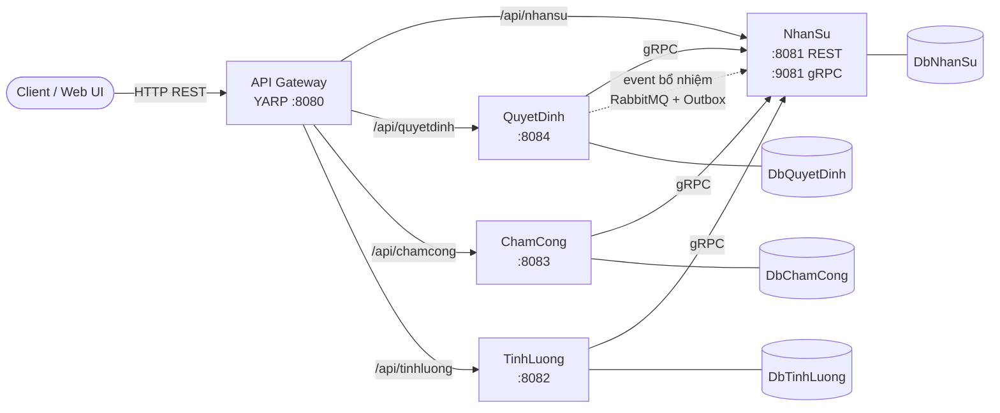
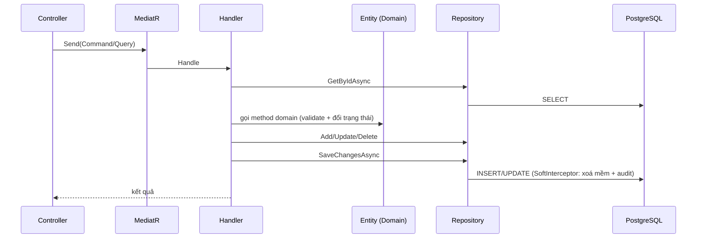
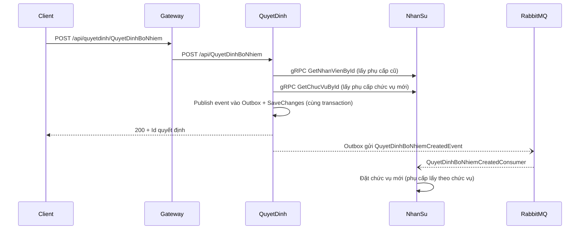

# Kiến trúc tổng quan

## Thành phần



| Thành phần | Thư mục | Vai trò |
|---|---|---|
| API Gateway | `ApiGateway/` | Điểm vào duy nhất cho client: reverse proxy (YARP), resilience (Polly), gộp Swagger, phục vụ web UI kiểm thử |
| Nhân sự | `QuanLyNhanSuMicroservice/` | Nguồn dữ liệu gốc về nhân viên, chức vụ, phòng ban, văn bằng, tài khoản; cấp JWT; gRPC server cho service khác |
| Quyết định | `QuyetDinhService/` | Quyết định bổ nhiệm và nâng lương; đẩy thay đổi sang NhanSu |
| Chấm công | `ChamCongService/` | Loại chấm công, phiếu đăng ký nghỉ, bảng chấm công tháng |
| Tính lương | `TinhLuongService/` | Kỳ tính lương và kết quả lương từng nhân viên |

Hạ tầng đi kèm: PostgreSQL 15 (dữ liệu nghiệp vụ), RabbitMQ (event), MongoDB (log Serilog), Prometheus + Grafana (metrics), Jaeger (tracing). Chi tiết port và cấu hình ở [configuration.md](configuration.md).

## Nguyên tắc chính

- **Database per service.** Mỗi service sở hữu một database PostgreSQL riêng (`DbNhanSu`, `DbQuyetDinh`, `DbChamCong`, `DbTinhLuong`) và không đọc thẳng database của service khác. Service khác chỉ lưu **Id** tham chiếu (ví dụ `MaNhanVien`, `ChucVuMoi` là Guid của NhanSu).
- **NhanSu là nguồn dữ liệu gốc.** Thông tin nhân viên/chức vụ luôn lấy từ NhanSu tại thời điểm cần, qua gRPC. Các service khác không giữ bản sao.
- **Ghi chéo service có hai cách.**
  - Đồng bộ qua gRPC: quyết định nâng lương gọi `UpdateLuong`.
  - Bất đồng bộ qua RabbitMQ với Transactional Outbox: quyết định bổ nhiệm.

  Xem [communication.md](communication.md).
- **Client chỉ nói chuyện với Gateway.** Gateway đổi prefix `/api/{service}/...` thành `/api/...` của service đích.

## Cấu trúc bên trong một service

Mỗi service là **một project ASP.NET Core** (một `.csproj`), chia thư mục theo Clean Architecture. Lấy NhanSu làm ví dụ:

```
QuanLyNhanSuMicroservice/
├── QuanLyNhanVien.API/             # Controllers, Filters (ResponseLoggingFilter), Grpc (NhanSuGrpcService)
├── QuanLyNhanVien.Application/     # Command/Query + DTO, Handlers (MediatR), Consumers, Events, Exception (middleware)
├── QuanLyNhanVien.Domain/          # Entities (rule nghiệp vụ), Repository interfaces, Domain exceptions
├── QuanLyNhanVien.Infrastructure/  # DbContext (EF Core), Repositories
├── Common/SoftInterceptor.cs       # Xoá mềm + audit khi SaveChanges
├── Extensions/                     # Cấu hình: Swagger, Database, Authentication, Messaging, Logging, Observability
├── Migrations/                     # EF Core migrations
└── Program.cs
```

Các service khác cùng cấu trúc, tên thư mục theo service (`QuyetDinhService.API`, `ChamCongService.Domain`, `TInhLuongService.Application`...).

Luồng xử lý một request:



Quy ước:

- **Rule nghiệp vụ nằm trong entity.** Constructor là `private`, entity được tạo qua `Create(...)` và đổi trạng thái qua method có validate (ví dụ `NhanVien.CapNhatLuong`). Setter để `private set`.
- **CQRS với MediatR.** Command/Query là `record` implement `IRequest<T>`. Ở NhanSu chúng nằm trong `Application/Command/...` (đặt tên `...DTO`); ở các service khác nằm trong `Application/Commands` và `Application/Query`.
- **Repository theo aggregate**, kế thừa `IBaseRepository<T>`. NhanSu đăng ký repository tự động bằng Scrutor (class có tên kết thúc bằng `Repository`); các service khác đăng ký thủ công trong `Extensions/DatabaseExtensions.cs`.
- **Mọi entity kế thừa `ObjectBase`**, gồm `Id` (Guid sinh trong constructor), `CreatedAt/UpdatedAt/CreatedBy/UpdatedBy`, và `IsDeleted/DeletedAt/DeletedBy`.

## Luồng nghiệp vụ tiêu biểu

### Bổ nhiệm nhân viên



Sửa quyết định phát `QuyetDinhBoNhiemUpdatedEvent` (áp chức vụ mới). Xoá quyết định phát `QuyetDinhBoNhiemDeletedEvent` (đưa nhân viên về chức vụ cũ). Phụ cấp của nhân viên luôn bằng phụ cấp hiện tại của chức vụ đang giữ.

### Nâng lương

QuyetDinh lưu quyết định, sau đó gọi **đồng bộ** gRPC `UpdateLuong` sang NhanSu:
- Sửa quyết định: gửi lương mới.
- Xoá quyết định: gửi lại lương cũ.

Nếu gRPC lỗi, quyết định vẫn được lưu, lỗi chỉ được ghi log. Xem [troubleshooting.md](troubleshooting.md#giới-hạn-đã-biết).

### Tính lương

TinhLuong gọi gRPC `GetAllNhanVien`, rồi:
- bỏ qua nhân viên có lương cơ bản ≤ 0;
- xoá mềm kết quả cũ của kỳ;
- tạo một dòng `NhanVienTinhLuong` cho mỗi nhân viên.

Chi tiết ở [services/tinhluong.md](services/tinhluong.md).
