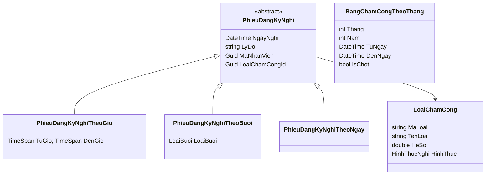

# Service Chấm công (ChamCong)

| | |
|---|---|
| Thư mục | `ChamCongService/` |
| Database | `DbChamCong` |
| Port | 8083 |
| Qua Gateway | `/api/chamcong/...` |
| Phụ thuộc | NhanSu (gRPC), PostgreSQL, RabbitMQ (publish) |

Quản lý loại chấm công, phiếu đăng ký nghỉ và bảng chấm công theo tháng.

## Mô hình dữ liệu

Ba loại phiếu nghỉ dùng chung một bảng (EF Core TPH). Enum được lưu và trả về dạng **số**:

| Enum | Giá trị |
|---|---|
| `HinhThucNghi` | `0` NghiTheoGio, `1` NghiTheoBuoi, `2` NghiTheoNgay |
| `LoaiBuoi` | `0` Sang, `1` Chieu |

`MaNhanVien` là Id nhân viên bên NhanSu.

## Rule nghiệp vụ

- **Loại chấm công:** mã và tên bắt buộc. `HinhThuc` quyết định loại phiếu được tạo.
- **Phiếu đăng ký nghỉ:**
  - lý do, nhân viên, loại chấm công, ngày nghỉ bắt buộc;
  - khi tạo, service gọi gRPC `GetNhanVienById` để chắc chắn nhân viên tồn tại bên NhanSu;
  - loại phiếu do `HinhThuc` của loại chấm công quyết định:
    - *Theo giờ*: dùng `tuGio`/`denGio` (thiếu thì là `00:00`); nếu cả hai > 0 thì giờ bắt đầu phải nhỏ hơn giờ kết thúc;
    - *Theo buổi*: dùng `loaiBuoi` (thiếu thì là buổi sáng);
    - *Theo ngày*: không cần thêm trường nào.
- **Bảng chấm công tháng:**
  - tháng 1–12, năm ≥ 2000, từ ngày < đến ngày;
  - **không sửa được khi đã chốt**; phải mở chốt trước.

## API (REST)

Qua Gateway: thay `/api` bằng `/api/chamcong`. Mọi endpoint cần JWT. `PUT` yêu cầu `id` trong body trùng với `{id}` trên URL.

### LoaiChamCong

| Method | Route | Body | Kết quả |
|---|---|---|---|
| GET | `/api/LoaiChamCong` | | Mảng `{ id, maLoai, tenLoai, heSo, hinhThuc, updatedAt }` |
| GET | `/api/LoaiChamCong/{id}` | | Một loại, hoặc 404 |
| POST | `/api/LoaiChamCong` | `{ maLoai, tenLoai, heSo, hinhThuc }` | Id (Guid) |
| PUT | `/api/LoaiChamCong/{id}` | `{ id, maLoai, tenLoai, heSo, hinhThuc, updatedAt }` | `{ message }` |
| DELETE | `/api/LoaiChamCong/{id}` | | `{ message }` |

### PhieuDangKyNghi

| Method | Route | Body | Kết quả |
|---|---|---|---|
| GET | `/api/PhieuDangKyNghi` | | Mảng `PhieuDangKyNghiDto` |
| GET | `/api/PhieuDangKyNghi/{id}` | | `PhieuDangKyNghiDto`, hoặc 404 |
| POST | `/api/PhieuDangKyNghi` | `{ ngayNghi, lyDo, maNhanVien, loaiChamCongId, tuGio?, denGio?, loaiBuoi? }` | Id |
| PUT | `/api/PhieuDangKyNghi/{id}` | `{ id, ngayNghi, lyDo, maNhanVien, loaiChamCongId, updatedAt, tuGio?, denGio?, loaiBuoi? }` | `{ message }`. **Hiện chưa đổi được trường nào**, xem bên dưới |
| DELETE | `/api/PhieuDangKyNghi/{id}` | | `{ message }` |

`PhieuDangKyNghiDto`: `id, ngayNghi, lyDo, maNhanVien, loaiChamCongId, loaiChamCongTen, hinhThuc, updatedAt, tuGio, denGio, loaiBuoi`. `tuGio`/`denGio` có dạng `"HH:mm:ss"`.

### BangChamCongTheoThang

| Method | Route | Body / query | Kết quả |
|---|---|---|---|
| GET | `/api/BangChamCongTheoThang` | | Mảng `{ id, thang, nam, tuNgay, denNgay, isChot, updatedAt }` |
| GET | `/api/BangChamCongTheoThang/{id}` | | Một bảng công, hoặc 404 |
| POST | `/api/BangChamCongTheoThang` | `{ thang, nam, tuNgay, denNgay }` | Id |
| PUT | `/api/BangChamCongTheoThang/{id}` | `{ id, thang, nam, tuNgay, denNgay, updatedAt }` | `{ message }` |
| DELETE | `/api/BangChamCongTheoThang/{id}` | | `{ message }` |
| PATCH | `/api/BangChamCongTheoThang/{id}/chot?updatedAt=...` | | `{ message }` |
| PATCH | `/api/BangChamCongTheoThang/{id}/mo-chot?updatedAt=...` | | `{ message }` |

`updatedAt` dùng cho optimistic concurrency. Nếu không khớp, service hiện trả **500**, chưa phải 409.

## Messaging

- **Publish** `PhieuDangKyNghiCreatedEvent { id, ngayNghi, lyDo, maNhanVien, loaiChamCongId }` khi tạo phiếu nghỉ. Event được publish trực tiếp, không qua outbox, và hiện chưa có consumer.

## Giới hạn hiện tại

- `PUT /api/PhieuDangKyNghi/{id}` chỉ chạm `UpdatedAt`. Handler chưa có method domain để sửa ngày, lý do hay giờ nghỉ. Muốn đổi thì xoá rồi tạo lại.
- Lỗi validate trong domain và "Nhân viên không tồn tại" đang dùng `Exception` thường, nên trả **500** thay vì 400/404.

## Migration

| Migration | Nội dung |
|---|---|
| `InitialCreate` | Bảng `AttendanceRecords` (entity `AttendanceRecord`, chưa dùng trong API) |
| `AddHinhThucToLoaiChamCong` | Bảng `LoaiChamCongs` (kèm hình thức nghỉ) |
| `RenamePhieuChamCongToPhieuDangKyNghi` | Bảng `PhieuDangKyNghis` (TPH cho 3 loại phiếu), khoá ngoại tới `LoaiChamCongs` |
| `AddBangChamCongTheoThang` | Bảng `BangChamCongTheoThangs` |

## Mã nguồn chính

| Nội dung | File |
|---|---|
| Entity | `ChamCongService.Domain/Entity/*.cs` |
| Handler | `ChamCongService.Application/Handlers/*.cs` |
| gRPC client | `ChamCongService.Application/Services/NhanSuServiceClient.cs` |
| DbContext | `ChamCongService.Infrastructure/Data/ChamCongDbContext.cs` |
