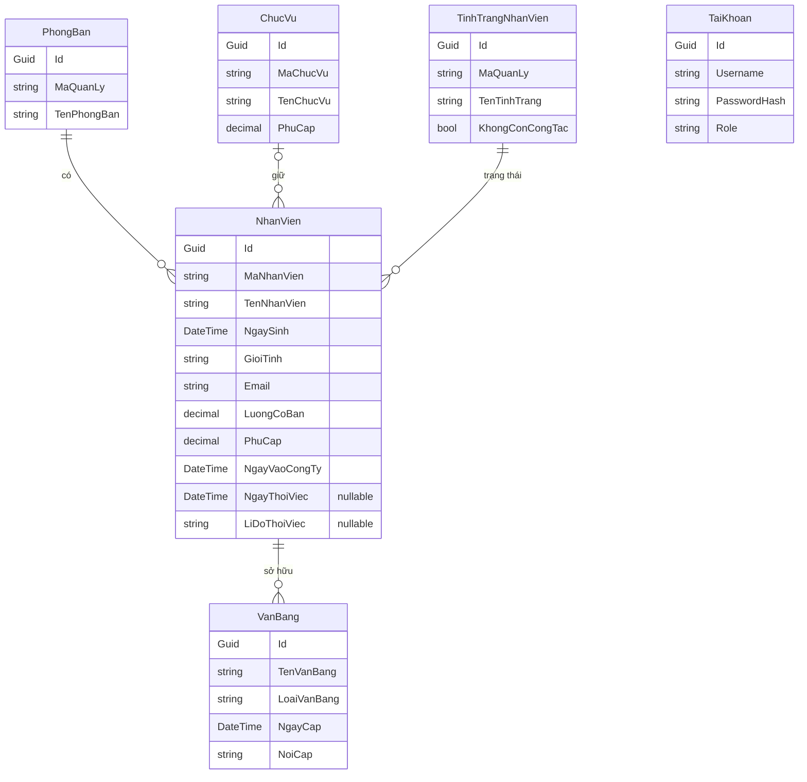

# Service Nhân sự (NhanSu)

| | |
|---|---|
| Thư mục | `QuanLyNhanSuMicroservice/` |
| Database | `DbNhanSu` |
| Port | 8081 (REST, HTTP/1.1), 9081 (gRPC, HTTP/2) |
| Qua Gateway | `/api/nhansu/...` |
| Phụ thuộc | PostgreSQL, RabbitMQ (consume event bổ nhiệm) |

NhanSu là **nguồn dữ liệu gốc** của nhân viên, phòng ban, chức vụ, văn bằng, tài khoản đăng nhập. Service này cấp JWT cho toàn hệ thống và mở gRPC server để các service khác đọc/cập nhật dữ liệu nhân sự.

## Mô hình dữ liệu



`TongLuong` của nhân viên là thuộc tính tính toán: `LuongCoBan + PhuCap`.

### Danh mục trạng thái nhân viên

Bảng `TinhTrangNhanVien` được seed bằng migration `SeedTinhTrangNhanVien`, với Id cố định (hằng số trong `TinhTrangNhanVien`):

| Id | Mã | Tên | `KhongConCongTac` |
|---|---|---|---|
| `5d1c9a3e-6f0b-4c2e-9a71-1b8e2f4d0a01` | `DANG_LAM_VIEC` | Đang làm việc | `false` |
| `5d1c9a3e-6f0b-4c2e-9a71-1b8e2f4d0a02` | `DA_NGHI_VIEC` | Đã nghỉ việc | `true` |

## Rule nghiệp vụ

**Nhân viên (`NhanVien`)**
- Bắt buộc: mã, họ tên, giới tính, email, phòng ban. Email phải chứa `@`. Ngày sinh không được ở tương lai.
- Mã nhân viên và email phải **duy nhất** (kiểm tra ở handler, trả `IsExistException` → 400).
- **Khi tạo mới:**
  - gán chức vụ được chọn, **phụ cấp = phụ cấp của chức vụ**;
  - gán trạng thái "Đang làm việc";
  - ngày vào công ty là `NgayVaoCongTy` trong request; nếu không truyền thì lấy ngày hôm nay. Chỉ giữ phần ngày, dạng UTC.
  - Ngày vào công ty không được ở tương lai và không được trước ngày sinh.
- `UpdatePosition(chucVu)`: đổi chức vụ, đồng thời đặt phụ cấp bằng phụ cấp của chức vụ mới.
- `CapNhatLuong(luong)`: lương ≥ 0.
- `SetNhanVienThoiViec(trạngThái, ngày, lýDo)`:
  - trạng thái mới phải là "không còn công tác";
  - phải có lý do;
  - ngày thôi việc không ở tương lai và không trước ngày vào công ty.

**Chức vụ:** mã và tên bắt buộc; phụ cấp ≥ 0.

**Phòng ban:** mã quản lý và tên bắt buộc. Lỗi được gom theo từng trường.

**Văn bằng:** tên và loại bắt buộc; phải thuộc một nhân viên đang tồn tại.

**Tài khoản:** username và mật khẩu bắt buộc. Mật khẩu được hash bằng BCrypt; role mặc định là `User`.

## API (REST)

Đường dẫn dưới đây tính tại service. Khi gọi qua Gateway, thêm prefix `/api/nhansu` thay cho `/api` (ví dụ `/api/nhansu/NhanVien`). Mọi endpoint cần JWT, trừ `Auth`.

### Auth

| Method | Route | Body | Kết quả |
|---|---|---|---|
| POST | `/api/Auth/register` | `{ "username", "password", "role" }` | `{ "message": "Đăng ký thành công." }`; trùng tên → 400 `{ "message" }` |
| POST | `/api/Auth/login` | `{ "username", "password" }` | `{ "token": "<JWT>" }`; sai tên/mật khẩu → 401 `{ "message" }` |

### NhanVien

| Method | Route | Body | Kết quả |
|---|---|---|---|
| GET | `/api/NhanVien` | | Mảng `NhanVienDto` (kèm phòng ban, chức vụ, văn bằng) |
| GET | `/api/NhanVien/{id}` | | `NhanVienDto`, hoặc 404 |
| POST | `/api/NhanVien` | `{ maNhanVien, tenNhanVien, ngaySinh, gioiTinh, email, phongBanID, chucVuID, ngayVaoCongTy? }` | Id (Guid) nhân viên mới |
| PUT | `/api/NhanVien/{id}` | `{ maNhanVien, tenNhanVien, ngaySinh, gioiTinh, email, phongBanID, chucVuID }` | `true` (mã nhân viên **không** được đổi) |
| DELETE | `/api/NhanVien/{id}` | | `true` (xoá mềm) |
| PATCH | `/api/NhanVien/{id}/update-luong` | `{ luongCoBan }` | `true` |
| PATCH | `/api/NhanVien/{id}/update-chuc-vu` | `{ chucVuID }` | `true` |

`NhanVienDto`:

```json
{
  "id": "…", "maNhanVien": "NV001", "tenNhanVien": "Nguyễn Văn A", "ngaySinh": "1995-05-10T00:00:00Z",
  "gioiTinh": "Nam", "email": "a@example.com", "luongCoBan": 15000000.75, "phuCap": 1000000,
  "phongBan": { "id": "…", "maPhongBan": "PB01", "tenPhongBan": "Kỹ thuật" },
  "chucVu": { "id": "…", "maChucVu": "NV", "tenChucVu": "Nhân viên", "phuCap": 1000000 },
  "vanBangs": [ { "id": "…", "tenVanBang": "Cử nhân CNTT", "loaiVanBang": "Đại học", "ngayCap": "…", "noiCap": "…", "nhanVienID": "…" } ]
}
```

### ChucVu

| Method | Route | Body | Kết quả |
|---|---|---|---|
| GET | `/api/ChucVu` | | Mảng `{ id, maChucVu, tenChucVu, phuCap }` |
| GET | `/api/ChucVu/{id}` | | Một chức vụ, hoặc 404 |
| POST | `/api/ChucVu` | `{ maChucVu, tenChucVu, phuCap }` | Id chức vụ mới |
| PUT | `/api/ChucVu/{id}` | `{ maChucVu, tenChucVu, phuCap }` | `true` |
| DELETE | `/api/ChucVu/{id}` | | `true` |

Đổi phụ cấp của chức vụ **không** tự cập nhật phụ cấp của nhân viên đang giữ chức vụ đó. Phụ cấp của nhân viên chỉ được tính lại khi chức vụ của họ được gán lại (`update-chuc-vu` hoặc qua quyết định bổ nhiệm).

### PhongBan

| Method | Route | Body | Kết quả |
|---|---|---|---|
| GET | `/api/PhongBan` | | Mảng `{ id, maPhongBan, tenPhongBan }` |
| POST | `/api/PhongBan` | `{ maPhongBan, tenPhongBan }` | 200, **body rỗng** (không trả Id, lấy Id từ GET) |
| PUT | `/api/PhongBan/{id}` | `{ maPhongBan, tenPhongBan }` | `true` |
| DELETE | `/api/PhongBan/{id}` | | `true` |

`maPhongBan` trong API được lưu vào cột `MaQuanLy` của entity.

### VanBang

| Method | Route | Body | Kết quả |
|---|---|---|---|
| GET | `/api/VanBang` | | Mảng `VanBangDto` |
| GET | `/api/VanBang/{id}` | | `VanBangDto`, hoặc 404 |
| GET | `/api/VanBang/nhanvien/{nhanVienId}` | | Văn bằng của một nhân viên |
| POST | `/api/VanBang` | `{ tenVanBang, loaiVanBang, ngayCap, noiCap, nhanVienID }` | `VanBangDto` vừa tạo |
| PUT | `/api/VanBang/{id}` | `{ tenVanBang, loaiVanBang, ngayCap, noiCap, nhanVienID }` | `VanBangDto` sau khi sửa |
| DELETE | `/api/VanBang/{id}` | | `true` |

## gRPC server

`NhanSuGrpcService` (port 9081) gồm `GetNhanVienById`, `GetAllNhanVien`, `GetChucVuById`, `UpdateLuong`, `UpdateBoNhiem`. Contract, quy ước kiểu dữ liệu và mã lỗi được mô tả ở [communication.md](../communication.md#grpc-tới-nhansu).

## Messaging

- **Consume:** `QuyetDinhBoNhiemCreatedEvent`, `QuyetDinhBoNhiemUpdatedEvent`, `QuyetDinhBoNhiemDeletedEvent` (đăng ký trong `Extensions/MessagingExtensions.cs`).
- **Publish:** `NhanVienCreatedEvent` khi tạo nhân viên (hiện chưa service nào consume).

## Migration

| Migration | Nội dung |
|---|---|
| `UpdateChucVuSchema`, `AddTaiKhoanTable`, `VanBang`, `UpdateLuongCoBan`, `xxxxx` | Lược đồ ban đầu: nhân viên, phòng ban, chức vụ, tài khoản, văn bằng, lương cơ bản |
| `LyDoThoiViec` | Ngày vào/thôi việc, lý do thôi việc, bảng `TinhTrangNhanVien` |
| `SeedTinhTrangNhanVien` | Seed 2 trạng thái mặc định |

## Mã nguồn chính

| Nội dung | File |
|---|---|
| Entity và rule | `QuanLyNhanVien.Domain/Entities/*.cs` |
| Handler nhân viên | `QuanLyNhanVien.Application/Handlers/NhanVienHandler/NhanVienHandlers.cs` |
| Đăng nhập/đăng ký | `QuanLyNhanVien.Application/Handlers/AuthHandler/AuthHandlers.cs` |
| gRPC server | `QuanLyNhanVien.API/Grpc/NhanSuGrpcService.cs` |
| Consumer RabbitMQ | `QuanLyNhanVien.Application/Consumers/*.cs` |
| DbContext + seed | `QuanLyNhanVien.Infrastructure/Persistence/Data/NhanSuDbContext.cs` |
